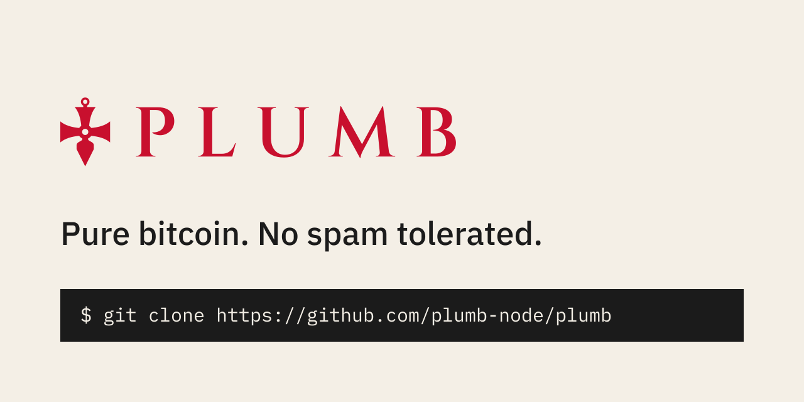

Plumb is Bitcoin Knots plus the spam-policy filters the Plumb maintainers
have reviewed and ACKed, whether they were opened against Knots or here, and
whether or not Knots merges them. Each release is one Knots release plus
those merges and one default of its own: `-datacarriersize` starts at 42
bytes, where Knots has started at 83 since v29.2.knots20251110.

It is a policy project, not a consensus project. The filters change what
your node relays and what your node mines. They do not change which blocks
are valid, so Plumb follows the same chain as the Knots release it is built
on.

It is a drop-in replacement for Knots: same `bitcoind` and `bitcoin-cli`
binaries, same `bitcoin.conf`, same data directory. You can switch back to
Knots at any time.

What Plumb ships
----------------

<!-- filters:start -->
- **[Fake output hashes and keys](plumb/FILTERS.md#fake-output-hashes-and-keys)**, `-rejectfakeoutputs`, from [knots#389](https://github.com/bitcoinknots/bitcoin/pull/389): counts outputs whose hash or key is data as data carrier bytes.
- **[Bare data envelopes](plumb/FILTERS.md#bare-data-envelopes)**, `-rejectbareenvelopes`, from [knots#319](https://github.com/bitcoinknots/bitcoin/pull/319): counts a run of pushes ended by OP_DROP or OP_2DROP as data carrier bytes.
- **[Fake multisig keys](plumb/FILTERS.md#fake-multisig-keys)**, `-rejectfakemultisig`, from [knots#422](https://github.com/bitcoinknots/bitcoin/pull/422): counts the keys of a multisig that no signature in the spend proves, beyond 10 per script, as data carrier bytes.
- **[Token messages](plumb/FILTERS.md#token-messages)**, `-rejecttokenmessages`, Plumb's own from [plumb#2](https://github.com/plumb-node/plumb/pull/2), no Knots pull request: refuses an OP_RETURN that holds a JSON token message or an Omni Layer message.

Every filter is on by default and is its own option. [plumb/FILTERS.md](plumb/FILTERS.md)
says what each one rejects and leaves alone, with an example transaction and
the line that turns it off. `-corepolicy` turns all of them off along with the
rest of the Knots policy. The node logs which filters are active at startup:

```
Plumb filter -rejectfakeoutputs=1 (knots#389)
Plumb filter -rejectbareenvelopes=1 (knots#319)
Plumb filter -rejectfakemultisig=1 (knots#422)
Plumb filter -rejecttokenmessages=1 (plumb#2)
```
<!-- filters:end -->

The 42-byte `-datacarriersize` is not a filter and has no switch of its own:
set `datacarriersize=83` to match Knots, and `-corepolicy` sets 83 too.
[plumb/FILTERS.md](plumb/FILTERS.md#lower-data-limits) says what 42 refuses
that 83 lets through.

The machine-readable list is [plumb/filters.json](plumb/filters.json), with
the exact commit of each pull request that was merged.

Recommended bitcoin.conf
------------------------

[plumb/conf/plumb.conf](plumb/conf/plumb.conf) for Plumb and
[plumb/conf/knots.conf](plumb/conf/knots.conf) for Knots, the same files as
on [cesspool.lol/check](https://cesspool.lol/check/#settings), which also
has the settings for Umbrel and StartOS. Each writes its filter settings
out, so a `corepolicy=1` set elsewhere can no longer reset them (it still
changes settings they do not set, such as the minimum relay fee), and sets
three values stricter than Knots' defaults: `datacarriersize=42` (Plumb's
own default), `datacarriercost=2` and `bytespersigopstrict=51`. The comment
above each says what it does;
[cesspool.lol](https://cesspool.lol/check/#fake-multisig) explains the
third, which refuses most fake multisig. If your `bitcoin.conf` already sets
one of these options, change or remove that line rather than adding a second
one.

A node that a Lightning node sends transactions through takes
[plumb/conf/plumb-lightning.conf](plumb/conf/plumb-lightning.conf) or
[plumb/conf/knots-lightning.conf](plumb/conf/knots-lightning.conf) instead:
the same files with the three settings a zero-fee commitment channel needs
(`subdustfeepenalty=0`, `mempooltruc=enforce` and
`permitephemeral=anchor,-send,dust`) and the dust fee settings written out.
The comments above each say what the change lets through;
[cesspool.lol/check/#lightning](https://cesspool.lol/check/#lightning) says
the rest.

Getting it
----------

Releases are signed git tags named after the Knots release they are built
on, for example `v29.4.2.knots20260508.plumb5`. Each release page carries
the source and, from plumb5 on, a pre-built `bitcoind` and `bitcoin-cli`
for x86_64 Linux; from plumb6 on, for 64-bit ARM (aarch64) Linux too.

### On Umbrel

Plumb is an app in Leo Haf's Misc community app store for Umbrel. The
install steps, how to check that it runs Plumb, and what to do when the
install fails are at [plumbnode.org/umbrel](https://plumbnode.org/umbrel/).

### Pre-built, x86_64 or aarch64 Linux

The tarballs run on any x86_64 or aarch64 Linux with glibc 2.31 or newer:
Debian 11, Ubuntu 20.04, RHEL 9 and everything later. The aarch64 build has
been tested under emulation on an x86_64 machine, not yet on ARM hardware.
Download the one for your machine (`uname -m` says which) together with
`SHA256SUMS` and `SHA256SUMS.asc` from the release page, then:

```sh
gpg --keyserver hkps://keys.openpgp.org --recv-keys 89F0E41D72CE523F4AA1CDB692CDFFB7C40CD1BA
gpg --verify SHA256SUMS.asc SHA256SUMS
sha256sum --ignore-missing -c SHA256SUMS
tar xzf bitcoin-*-"$(uname -m)"-linux-gnu.tar.gz
sudo install -m 0755 bitcoin-*/bin/bitcoind bitcoin-*/bin/bitcoin-cli /usr/local/bin/
```

Install nothing until `gpg --verify` reports a good signature from Jason
Sopko and `sha256sum` says `OK`. It is one person's build on one machine,
not a reproducible build; the recipe is
[plumb/tools/release-tarball](plumb/tools/release-tarball).

### From source

```sh
git clone https://github.com/plumb-node/plumb
cd plumb
git checkout v29.4.2.knots20260508.plumb1
git verify-tag v29.4.2.knots20260508.plumb1
cmake -B build -DBUILD_GUI=OFF
cmake --build build -j"$(nproc)"
```

Tags are signed by Jason Sopko,
`89F0 E41D 72CE 523F 4AA1  CDB6 92CD FFB7 C40C D1BA`. Fetch the key with
`gpg --keyserver hkps://keys.openpgp.org --recv-keys 89F0E41D72CE523F4AA1CDB692CDFFB7C40CD1BA`
or from https://github.com/jasonsopko.gpg.

Build dependencies and options are the same as Knots; see
[doc/build-unix.md](doc/build-unix.md) and the other `doc/build-*.md` files.
The binaries land in `build/bin/`.

To hear about new releases, use Watch, Custom, Releases on this repository.
Each release page lists what changed and the Knots release underneath it.

Submitting a filter
-------------------

Plumb takes anti-spam policy filters as pull requests on this repository. If
you have one open against Knots, open it here too and link the two; we
review it on its own merits and keep shipping it whatever happens upstream.
A filter that Knots closes stays in Plumb.

Plumb also writes filters of its own, for shapes no Knots pull request
covers. They go through a pull request here and the same bar as any other,
and the filter list marks them as Plumb's own.

What a filter needs:

1. Its own option, default on, turned off by `-corepolicy`, the same shape
   as `-rejectparasites`.
2. Unit or functional tests for what it rejects and what it lets through.
3. Numbers from the chain: how many transactions it would have rejected
   over a stated block range, and a look at the ones that might be payments.
   A filter that blocks ordinary wallet spends does not ship, however much
   data it catches.

We review it on the pull request, run it on a mainnet node, and post the
ACK there. It is merged at the commit that was ACKed and kept on its own
`filter/<option>` branch here, so it survives even if the author's branch
goes away. If the author stops maintaining it, we carry it forward to each
new Knots release ourselves.

To submit one, [open a pull request](https://github.com/plumb-node/plumb/compare).
No code yet, or a filter open against Knots you want us to look at? Use the
[Propose a filter](https://github.com/plumb-node/plumb/issues/new?template=propose-filter.yml)
form. Found a new embedding shape and only have a transaction id or two? Use
the [Embedding shape](https://github.com/plumb-node/plumb/issues/new?template=embedding.yml)
form.

See [plumb/MAINTAINING.md](plumb/MAINTAINING.md) for the merge and release
process.

Reporting problems
------------------

Report Plumb problems [here](https://github.com/plumb-node/plumb/issues),
not to Knots. If a problem also happens on the Knots release underneath,
it belongs upstream at https://github.com/bitcoinknots/bitcoin. Security
issues go through [SECURITY.md](SECURITY.md).

License
-------

Plumb is released under the terms of the MIT license, the same as Bitcoin
Knots and Bitcoin Core. See [COPYING](COPYING). It is built on the work of
the Bitcoin Core and Bitcoin Knots developers; see https://bitcoinknots.org
for Knots itself.
